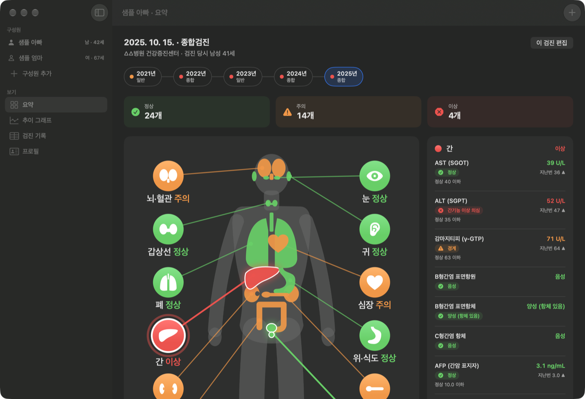
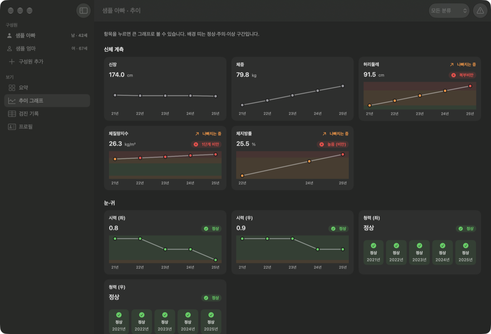

# 건강하면됐지

가족의 건강검진 결과를 해마다 모아 두고, 한눈에 보는 맥 앱입니다.

### [⬇︎ 최신 버전 내려받기](https://github.com/gotgam100/healthOK/releases/latest/download/HealthOK.zip)

macOS 13(Ventura) 이상 · Apple 실리콘·인텔 맥 모두 지원 · [모든 버전 보기](https://github.com/gotgam100/healthOK/releases)

## 할 수 있는 것

- **가족별 검진 기록**: 구성원마다 해마다 받은 검진 결과를 표로 모아 봅니다.
- **정상·주의·이상 판정**: 성별과 검진 당시 나이에 맞는 기준으로 수치를 판정하고, 참고치를 함께 보여 줍니다.
- **전신 인포그래픽**: 간·신장·심장 등 부위별 상태를 그림으로 한눈에 봅니다.
- **추이 그래프**: 해마다 수치가 어떻게 바뀌었는지, 나빠지고 있는 항목은 무엇인지 보여 줍니다.
- **AI에게 물어보기**: 기록을 Markdown 파일로 내보내 ChatGPT·Claude 같은 AI에 올려 질문할 수 있습니다.
- **다른 맥으로 옮기기**: 기록을 파일로 내보내고 가져올 수 있습니다.
- **자동 업데이트 알림**: 새 버전이 나오면 앱이 알려 줍니다.

## 설치

1. 위의 **최신 버전 내려받기**를 눌러 zip 파일을 받습니다.
2. 압축을 풀고 `건강하면됐지.app`을 **응용 프로그램** 폴더로 옮깁니다.
3. 앱을 엽니다. 처음 한 번 "인터넷에서 다운로드한 앱"이라는 확인 창이 나오면 **열기**를 누르면 됩니다.
   (Apple 공증을 받은 앱입니다)

새 버전으로 바꿀 때는 앱만 바꾸면 됩니다. 기록은 따로 저장되어 있어 그대로 남습니다.

## 개인 정보

기록은 내 맥(`~/Library/Application Support/HealthCheckup/`)에만 저장되고, 어디로도 보내지 않습니다.
앱이 인터넷에 접속하는 것은 새 버전이 있는지 확인할 때뿐입니다.

> 판정은 일반적인 기준으로 계산한 참고 정보이며, 의료진의 진단을 대신하지 않습니다.
